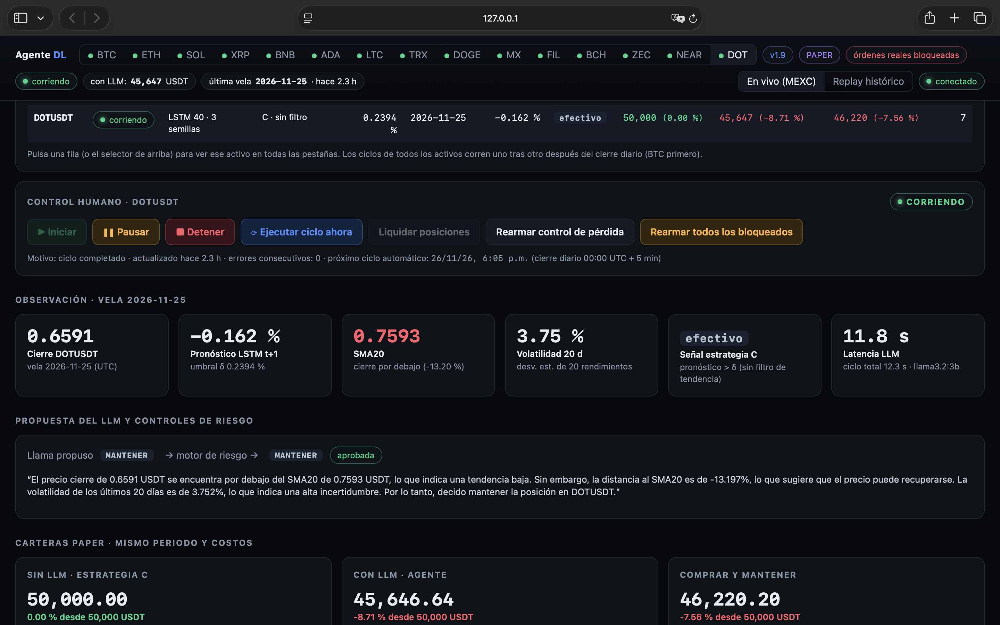

# Deep Learning para Finanzas — práctica y laboratorio de señales con IA

Este repositorio reúne la **práctica** del curso, con el modelo de pronóstico de BTC/USDT, y el **proyecto final**: un sistema de IA que analiza cada día 15 pares de MEXC con el modelo LSTM de cada activo, un LLM local (Ollama), controles de riesgo deterministas y una interfaz web.

> **Versión actual: v2.0, laboratorio de señales.** Por indicación del profesor, el sistema ya no muestra saldos: en realidad no compra nada. Cuando el modelo de un activo da señal de compra (o de venta) y pasa los controles de riesgo, **envía un aviso por correo** para que el usuario decida si compra a mano en MEXC. Ver [Laboratorio de señales y avisos por correo](#laboratorio-de-señales-y-avisos-por-correo-v20).
>
> El sistema **no envía órdenes reales**. Solo lee datos públicos de MEXC; la simulación Paper sigue por dentro para evaluar la señal. Las claves y el teléfono no están en el repositorio.

**Informe del proyecto final:** [`Informe_Proyecto_Final_Agente_IA.md`](Informe_Proyecto_Final_Agente_IA.md) (o en PDF: [`Informe_Proyecto_Final_Agente_IA.pdf`](Informe_Proyecto_Final_Agente_IA.pdf)).

**Presentación ejecutiva:** [`Presentacion_Ejecutiva_Agente_IA.pdf`](Presentacion_Ejecutiva_Agente_IA.pdf).

---

## Cumplimiento de la entrega

| Indicación de la entrega | Dónde se cumple |
|---|---|
| 1. Presentación ejecutiva del sistema | [`Presentacion_Ejecutiva_Agente_IA.pdf`](Presentacion_Ejecutiva_Agente_IA.pdf) (12 diapositivas) |
| 2. Git con el código del sistema | Este repositorio: [`agente/backend/`](agente/backend/) (FastAPI), [`agente/frontend/`](agente/frontend/) (React + TypeScript), modelos, notebooks y datos |
| 3. README completo con versiones y avances | Este archivo: [Versiones de la app](#versiones-de-la-app) y [Avances del proyecto](#avances-del-proyecto); detalle en [`agente/CHANGELOG.md`](agente/CHANGELOG.md) |
| 4. Datos reales de MEXC | [Datos reales de MEXC](#datos-reales-de-mexc): velas diarias, reglas del par y precio actual leídos de la API pública de MEXC |
| 5. Operaciones y PnL | [Operaciones y PnL](#operaciones-y-pnl): operaciones y PnL de la simulación interna con la que se evalúa la señal. Desde la v2.0 la interfaz no muestra saldos (indicación del profesor); hasta la v1.9 se veían en la pestaña Operaciones ([captura](agente/evidencia/capturas/02_operaciones_paper.png)) |
| Indicación del 26 nov: quitar saldos y avisar cuándo se puede comprar a mano | [Laboratorio de señales y avisos por correo](#laboratorio-de-señales-y-avisos-por-correo-v20) (v2.0) |

---

## Laboratorio de señales y avisos por correo (v2.0)

Desde el 26 nov 2026 el sistema funciona como **laboratorio**: no compra ni maneja saldos, y avisa cuándo se podría comprar.

1. Cada día, después del cierre de la vela de 00:00 UTC, analiza los 15 pares con su modelo LSTM y los controles de riesgo.
2. Si la estrategia del modelo de un activo **compra**, llega un correo con el activo, la vela, el cierre, el pronóstico frente a su umbral δ y un stop móvil sugerido. Si después **vende** (por señal del modelo o por stop), llega el aviso de venta con el motivo.
3. El usuario decide si compra o vende a mano en MEXC. El LLM no dispara avisos: en vivo no aportó valor (ver resultados).

Ejemplo del aviso (formato real, con las cifras de LTC del 25 nov):

```
Asunto: Laboratorio DL · señal de COMPRA en LTCUSDT (vela 2026-11-25)

Laboratorio DL · señal de COMPRA
LTCUSDT · vela 2026-11-25 (UTC)
Cierre: 42.80 USDT
Pronóstico del modelo: +0.197 % (umbral 0.086 %)
Stop móvil sugerido: 39.98 USDT.
Operación manual opcional en MEXC. El laboratorio no envía órdenes.
```

- **Servicio:** correo por Gmail (SMTP con TLS) con una contraseña de aplicación. Configuración en [`agente/README.md`](agente/README.md#avisos-por-correo-v20). Primero se intentó WhatsApp; se cambió a correo porque el bot gratuito (CallMeBot) tenía el cupo lleno y la API de Meta necesita una plantilla aprobada. El código de WhatsApp se conserva como alternativa deshabilitada.
- **Seguridad:** el usuario, la contraseña de aplicación y el destino solo viven en `agente/.env`; el backend solo se conecta a servidores SMTP permitidos con TLS y nunca guarda la contraseña ni las direcciones completas en la bitácora.
- **Sin duplicados ni efectos en el ciclo:** cada aviso se guarda en la base del activo y no se repite para la misma vela; si el correo falla, el agente sigue igual y lo registra.
- **Interfaz:** nueva pestaña **Señales** con las señales del día, las señales activas, el estado de los avisos (con aviso de prueba) y el historial de avisos. Se quitaron todos los saldos de la interfaz.

---

## Evaluación de la señal en vivo (simulación interna, 15 activos, datos al 25 nov 2026)

La interfaz ya no muestra saldos, pero el protocolo (bloque 16) pide comparar la estrategia sin LLM, con LLM y comprar y mantener. Para eso se conserva la simulación Paper por dentro. Cada activo tiene tres carteras simuladas de 50,000 USDT con el mismo periodo y costos:

| Cartera | Saldo final (USDT) | PnL neto (USDT) | Rendimiento neto | Drawdown máx. | Órdenes | Win Rate |
|---|---|---|---|---|---|---|
| Sin LLM (estrategia del modelo + riesgo) | 751,975.51 | **+1,975.51** | **+0.26 %** | −0.93 % | 13 | 80 % (4 de 5) |
| Con LLM (propuesta del LLM + el mismo riesgo) | 707,218.32 | **−42,781.68** | **−5.70 %** | −7.47 % | 32 | 0 % (0 de 9) |
| Comprar y mantener | 716,919.76 | **−33,080.24** | **−4.41 %** | −7.04 % | 15 | — |

Capital inicial: 750,000 USDT por cartera (15 activos × 50,000). Costo 0 %, como pide el protocolo.

En este periodo el LLM no aportó valor:
- Nunca propuso vender.
- Propuso comprar sin señal del modelo en 20 de 114 ciclos.
- Todas sus salidas fueron por stop.

El motor de riesgo lo contuvo: rechazó 18 acciones no permitidas y forzó 9 ventas por stop. El detalle por activo y el análisis de las justificaciones del LLM están en el [informe](Informe_Proyecto_Final_Agente_IA.md).

**Meta de +20 %:** no se alcanzó; los periodos evaluados fueron bajistas y el protocolo solo permite comprar o estar en efectivo. Lo que sí se logró:
- El modelo profundo superó a la regresión lineal: en TE, −3.25 % frente a −27.98 %, con un RMSE menor.
- Protegió el capital frente a comprar y mantener: −3.25 % frente a −31.57 % en TE de BTC, mejor en 12 de 15 activos.
- En vivo, la cartera del modelo fue la única positiva (+0.26 %).

Ver la sección 10 del [informe](Informe_Proyecto_Final_Agente_IA.md).

### Capturas de la interfaz

Capturas de la v1.9 (25 nov), antes de quitar los saldos de la interfaz. La captura de la pestaña **Señales** de la v2.0 se agrega después del ciclo del 26 nov.

| Operaciones (v1.9, 15 activos, modo Paper) | Cerebro (flujo de módulos) |
|---|---|
|  |  |
| **Control humano, observación y propuesta del LLM** | **Red neuronal en vivo** |
|  |  |

Más capturas (decisiones y órdenes, salud del sistema, auditoría y bitácora) en [`agente/evidencia/capturas/`](agente/evidencia/capturas/).

---

## Datos reales de MEXC

El backend consume la API pública de MEXC (`https://api.mexc.com`), sin clave de trading:

| Endpoint | Uso | Dónde se ve |
|---|---|---|
| `GET /api/v3/klines` | Velas diarias cerradas (00:00 UTC) de los 15 pares: entrada del modelo, SMA20, volatilidad y precio de ejecución Paper | Pestañas Resumen, Mercado, Escáner y Estrategia; columna `fecha_vela` de [`ciclos.csv`](agente/registros/ciclos.csv) |
| `GET /api/v3/exchangeInfo` | Paso de cantidad, precisión y monto mínimo de cada par, que respeta el simulador | Validación de cada orden Paper |
| `GET /api/v3/ticker/price` | Precio actual de los 15 pares (en caché 30 s), solo informativo | Pestaña Operaciones (precio actual y PnL a precio actual) |
| `GET /api/v3/ping`, `GET /api/v3/time` | Salud de la conexión y hora del servidor | Sistema → Salud |

Cada ciclo guarda la fecha de la vela usada y la antigüedad del dato; si el dato tiene más de 26 h, el agente no opera.

**Cuenta demo de MEXC:** pendiente de revisión con el profesor. La API de MEXC no ofrece cuenta de prueba (sandbox): se conecta directo a la cuenta real, y la demo de MEXC solo existe en la web de futuros. Por eso, y porque el protocolo pide no enviar órdenes reales, las compras y ventas se ejecutan en el simulador Paper propio con precios reales de MEXC.

---

## Operaciones y PnL

Son las operaciones de la **simulación interna** con la que se evalúa la señal. Desde la v2.0 la interfaz ya no las muestra (el laboratorio no compra); los datos siguen en [`agente/registros/`](agente/registros/) y en la API (`GET /api/operaciones`). Hasta la v1.9, la pestaña **Operaciones** sumaba los 15 activos de la cartera elegida y mostraba:
- saldo total, PnL neto, PnL realizado y no realizado, efectivo e invertido;
- posiciones abiertas, con fecha y precio de compra, precio actual de MEXC, stop móvil y PnL;
- historial de operaciones cerradas, con motivo de salida y PnL.

PnL al cierre de la vela del 25 nov 2026 (datos en vivo):

| Cartera | PnL realizado (USDT) | PnL no realizado (USDT) | PnL neto (USDT) |
|---|---|---|---|
| Sin LLM | +1,997.13 | −21.62 | **+1,975.51** |
| Con LLM | −40,402.16 | −2,379.52 | **−42,781.68** |
| Comprar y mantener | 0.00 | −33,080.24 | **−33,080.24** |

Operaciones cerradas en vivo:

| Activo | Cartera | Compra | Precio compra | Venta | Precio venta | PnL (USDT) | Salida |
|---|---|---|---|---|---|---|---|
| SOLUSDT | Sin LLM | 17 nov | 75.19 | 20 nov | 68.88 | −4,196.02 | Stop móvil |
| BNBUSDT | Sin LLM | 20 nov | 540.91 | 21 nov | 548.62 | +712.68 | Señal del modelo |
| ETHUSDT | Sin LLM | 20 nov | 1,623.12 | 21 nov | 1,685.70 | +1,927.76 | Señal del modelo |
| ZECUSDT | Sin LLM | 20 nov | 759.52 | 21 nov | 780.22 | +1,362.70 | Señal del modelo |
| ZECUSDT | Sin LLM | 24 nov | 739.71 | 25 nov | 771.25 | +2,190.01 | Señal del modelo |
| BTCUSDT | Con LLM | 14 nov | 64,142.08 | 20 nov | 58,954.52 | −4,043.80 | Stop móvil |
| ETHUSDT | Con LLM | 17 nov | 1,824.97 | 20 nov | 1,623.12 | −5,530.23 | Stop móvil |
| SOLUSDT | Con LLM | 17 nov | 75.19 | 20 nov | 68.88 | −4,196.02 | Stop móvil |
| BNBUSDT | Con LLM | 19 nov | 580.15 | 20 nov | 540.91 | −3,381.86 | Stop móvil |
| NEARUSDT | Con LLM | 19 nov | 3.2077 | 20 nov | 2.8508 | −5,563.18 | Stop móvil |
| ZECUSDT | Con LLM | 19 nov | 894.37 | 20 nov | 759.52 | −7,538.79 | Stop móvil |
| DOTUSDT | Con LLM | 19 nov | 0.7130 | 21 nov | 0.6526 | −4,235.62 | Stop móvil |
| FILUSDT | Con LLM | 19 nov | 0.5766 | 21 nov | 0.5203 | −4,882.07 | Stop móvil |
| TRXUSDT | Con LLM | 19 nov | 0.3105 | 25 nov | 0.3041 | −1,030.59 | Stop móvil |

Todas las órdenes (ejecutadas y rechazadas), con fecha, precio, monto y motivo, están en [`ordenes.csv`](agente/registros/ordenes.csv); las operaciones cerradas, incluida la del replay, en [`operaciones_cerradas.csv`](agente/registros/operaciones_cerradas.csv); el saldo diario de cada cartera, en [`serie_patrimonio_total.csv`](agente/registros/serie_patrimonio_total.csv).

---

## Versiones de la app

Cada modificación al programa sube la versión. El número está en [`agente/config/agente.json`](agente/config/agente.json), aparece en la barra superior de la interfaz y se guarda en cada ciclo. Detalle completo en [`agente/CHANGELOG.md`](agente/CHANGELOG.md).

| Versión | Fecha | Cambios principales | Pruebas |
|---|---|---|---|
| v1.0 | 15 nov 2026 | Versión base: backend FastAPI con API key, ensamble LSTM de BTC, LLM local en Ollama detrás de un gateway, motor de riesgo, simulador Paper, SQLite, tres carteras y la interfaz con sus 7 pestañas. Primer ciclo en vivo: vela del 14 nov | 43 |
| v1.1 | 16 nov 2026 | Instancia de demostración separada (`AGENTE_CONFIG`) para probar los nueve errores sin tocar los ciclos en vivo | 44 |
| v1.2 | 16 nov 2026 | Base propia para la demostración de JSON inválido | 44 |
| v1.3 | 17 nov 2026 | Multi-activo: ETH, SOL y XRP con modelo, base, carteras y control propios; huellas SHA-256 de modelos; selector de activo | 62 |
| v1.4 | 17 nov 2026 | XRP retirado tras fallar su primer ciclo (Ollama no respondió); el agente se pausó sin operar | 60 |
| v1.5 | 19 nov 2026 | Límite de 400 tokens en las respuestas del LLM (causa del fallo de XRP); XRP regresa | 68 |
| v1.6 | 19 nov 2026 | Diez activos más elegidos por regla de volumen (14 pares); decimales de precio por activo | 90 |
| v1.7 | 19 nov 2026 | DOT reemplaza al token respaldado por oro elegido por error: 15 pares | 92 |
| v1.8 | 20 nov 2026 | Pestaña Operaciones rediseñada: saldo total, PnL, posiciones abiertas, historial y precio actual de MEXC | 96 |
| v1.9 | 20 nov 2026 | Botón «Rearmar todos los bloqueados» y regla diaria de rearme del límite de pérdida | 97 |
| **v2.0** | 26 nov 2026 | **Laboratorio de señales:** avisos por correo cuando el modelo compra o vende (WhatsApp queda como alternativa); pestaña Señales; la interfaz ya no muestra saldos (indicación del profesor). La simulación sigue por dentro solo para evaluar | 119 |

---

## Avances del proyecto

| Fecha | Avance |
|---|---|
| 5 nov 2026 | Avance 1 (capítulo 7): descarga de BTC/USDT de MEXC, auditoría, partición TR/VA/TE y referencias. Avance 2 (capítulo 8): MLP y LSTM entrenados en GPU T4 |
| 6 nov 2026 | Avance 3 (capítulo 9): ventanas expansivas y umbrales |
| 7 nov 2026 | Avance 4 (capítulo 10): especificación del entorno del agente y pruebas de abuso |
| 12 nov 2026 | Avance 5 (capítulo 11): indicadores, estrategia D, configuración congelada y evaluación única en TE; informe de la práctica |
| 15 nov 2026 | Agente v1.0; replay histórico de BTC (5–14 nov) y primer ciclo en vivo |
| 16 nov 2026 | Demostración de los nueve escenarios de error (v1.1–v1.2) |
| 17 nov 2026 | Agente multi-activo con ETH, SOL y XRP (v1.3–v1.4) |
| 19 nov 2026 | 15 activos (v1.5–v1.7) |
| 20 nov 2026 | Pestaña Operaciones y rearme de bloqueos (v1.8–v1.9) |
| 14–25 nov 2026 | Ciclos diarios en vivo: 114 ciclos válidos en los 15 activos, más 10 de replay en BTC |
| 25 nov 2026 | Exportación de registros, evidencia de Ollama local y pruebas, capturas, informe final y repositorio público |
| 26 nov 2026 | Presentación ejecutiva; README con versiones, avances, datos de MEXC, operaciones y PnL. Por indicación del profesor, v2.0: laboratorio de señales sin saldos y con avisos por correo. La conexión con la cuenta demo de MEXC queda pendiente (en revisión con el profesor) |

Las fechas de los avances de la práctica son las de su ejecución en Colab T4 (UTC), registradas en [`evidencia_t4/`](evidencia_t4/).

---

## Cómo funciona el agente

```
React + TypeScript (5173) ──X-API-Key──▶ Backend FastAPI (127.0.0.1:8000)
     ├─ MEXC API pública: velas diarias (solo lectura; sin rutas de órdenes reales)
     ├─ Un agente por activo: ensamble de 3 LSTM + escaladores versionados
     ├─ Gateway propio (8001) ──X-API-Key──▶ Ollama local (llama3.2:3b)
     ├─ Motor de riesgo determinista (el LLM no puede saltarlo)
     ├─ Simulador Paper (saldo, tamaño mínimo y precisión del par)
     └─ SQLite: ciclos, decisiones, órdenes, patrimonio y eventos
```

Una vez al día, después del cierre de la vela de 00:00 UTC, cada activo:
1. Consulta las velas cerradas de MEXC y valida la fecha y la antigüedad del dato.
2. Calcula los 20 rezagos y obtiene el pronóstico del modelo.
3. Pide al LLM una propuesta en JSON (comprar, mantener o vender) con una justificación breve.
4. Valida la propuesta y aplica los controles de riesgo:
   - límite de exposición;
   - pérdida diaria máxima de 3 %;
   - stop móvil;
   - antigüedad máxima del dato de 26 h.
5. Ejecuta en la simulación Paper interna, guarda todo y muestra la señal en la interfaz.
6. Desde la v2.0, si la estrategia del modelo compra o vende, envía el aviso por correo.

Si falla una dependencia (MEXC, Ollama, clave incorrecta, JSON inválido, dato atrasado, etc.), el agente reintenta con espera creciente y se pausa sin operar. Los nueve escenarios de error del protocolo están demostrados en [`agente/evidencia/demostracion_errores.md`](agente/evidencia/demostracion_errores.md).

### Activos

BTC, ETH, SOL, XRP, BNB, ADA, LTC, TRX, DOGE, MX, FIL, BCH, ZEC, NEAR y DOT contra USDT.
- Cada uno tiene su propio modelo, entrenado y validado con sus datos (TR/VA/TE 70/15/15).
- La estrategia de cada uno (C o D) se eligió con el conjunto de validación.
- Los activos extra se eligieron con una regla de volumen fijada antes de entrenar.

---

## Ejecutarlo

Requisitos: Python 3.13, Node.js y [Ollama](https://ollama.com) con el modelo `llama3.2:3b`. Las instrucciones completas están en [`agente/README.md`](agente/README.md).

```bash
# 1. Entorno de Python y claves (una sola vez, desde esta carpeta)
python3.13 -m venv .venv && source .venv/bin/activate
pip install -r agente/backend/requirements.txt
cp agente/.env.example agente/.env      # dos claves propias y, opcional, los datos del correo para los avisos (ver el archivo)
ollama pull llama3.2:3b

# 2. Gateway del LLM y backend (dos terminales, en agente/backend)
uvicorn gateway.main:app --host 127.0.0.1 --port 8001
uvicorn app.main:app --host 127.0.0.1 --port 8000

# 3. Interfaz (en agente/frontend)
npm install && npm run dev               # http://127.0.0.1:5173

# Pruebas y registros
cd agente/backend && python -m pytest    # 119 pruebas automatizadas
python agente/exportar_registros.py      # exporta las bases a CSV y calcula las métricas del informe
```

---

## Estructura del repositorio

| Carpeta o archivo | Contenido |
|---|---|
| [`Informe_Proyecto_Final_Agente_IA.md`](Informe_Proyecto_Final_Agente_IA.md) · [`Informe_Proyecto_Final_Agente_IA.pdf`](Informe_Proyecto_Final_Agente_IA.pdf) | Informe del proyecto final (bloques 14–16 del protocolo) |
| [`Presentacion_Ejecutiva_Agente_IA.pdf`](Presentacion_Ejecutiva_Agente_IA.pdf) | Presentación ejecutiva del sistema |
| [`agente/`](agente/) | El agente: `backend/` (FastAPI + gateway de Ollama + pruebas), `frontend/` (React + TypeScript), `config/` (configuración de riesgo, LLM, activos y avisos), [`README.md`](agente/README.md) y [`CHANGELOG.md`](agente/CHANGELOG.md) (versiones v1.0 a v2.0) |
| [`agente/registros/`](agente/registros/) | Registros del agente en CSV (ciclos, decisiones, órdenes, patrimonio y eventos) y métricas calculadas |
| [`agente/evidencia/`](agente/evidencia/) | Verificación de los modelos en la computadora local, replay histórico de BTC y demostración de los nueve errores |
| [`notebooks/`](notebooks/) | Notebooks de Colab: avances de la práctica (`practica/`) y entrenamiento de los activos extra |
| [`modelos/`](modelos/) | Modelos y escaladores de la práctica (BTC); el agente usa los de `modelos/cap11/` |
| [`activos_extra/`](activos_extra/), [`activos_extra_lote2/`](activos_extra_lote2/), [`activos_extra_lote3/`](activos_extra_lote3/) | Modelos, escaladores, resultados y figuras de los 14 activos extra |
| [`datos/`](datos/), [`resultados/`](resultados/), [`figuras/`](figuras/), [`evidencia_t4/`](evidencia_t4/), [`bitacora/`](bitacora/) | Datos de MEXC, resultados, figuras, evidencia del entrenamiento en GPU T4 y bitácora de la práctica |
| [`Informe/`](Informe/) | Informe final de la práctica y anexos |

---

## Dónde está cada entregable del protocolo

### Práctica (avances 1 a 5, capítulos 7 a 11)

Los notebooks conservan sus salidas y se pueden abrir en Colab (solo lectura) desde los enlaces.

| Avance | Notebook | Abrir en Colab | Resultados principales |
|---|---|---|---|
| 1 · Capítulo 7: datos, partición y referencias | [`DLF_Cap08_Avance1.ipynb`](notebooks/practica/DLF_Cap08_Avance1.ipynb) | [Colab](https://colab.research.google.com/github/prisfig/agente_dl/blob/main/notebooks/practica/DLF_Cap08_Avance1.ipynb) | [`ficha_activo.json`](resultados/ficha_activo.json), [`diccionario_datos.csv`](resultados/diccionario_datos.csv), [`auditoria_datos.csv`](resultados/auditoria_datos.csv), [`particiones.csv`](resultados/particiones.csv), [`comparacion_modelos_cap7_VA.csv`](resultados/comparacion_modelos_cap7_VA.csv), [`hipotesis_tecnica.json`](resultados/hipotesis_tecnica.json) |
| 2 · Capítulo 8: MLP y LSTM en T4 | [`DLF_Cap08_Avance2.ipynb`](notebooks/practica/DLF_Cap08_Avance2.ipynb) | [Colab](https://colab.research.google.com/github/prisfig/agente_dl/blob/main/notebooks/practica/DLF_Cap08_Avance2.ipynb) | [`busqueda_configuraciones_cap8.csv`](resultados/busqueda_configuraciones_cap8.csv), [`resumen_semillas_cap8.csv`](resultados/resumen_semillas_cap8.csv), [`seleccion_cap8.json`](resultados/seleccion_cap8.json), curvas en [`figuras/`](figuras/) |
| 3 · Capítulo 9: ventanas expansivas y umbrales | [`DLF_Cap09_Avance3.ipynb`](notebooks/practica/DLF_Cap09_Avance3.ipynb) | [Colab](https://colab.research.google.com/github/prisfig/agente_dl/blob/main/notebooks/practica/DLF_Cap09_Avance3.ipynb) | [`ventanas_expansivas_cap9.csv`](resultados/ventanas_expansivas_cap9.csv), [`errores_por_ventana_cap9.csv`](resultados/errores_por_ventana_cap9.csv), [`umbrales_probados_cap9_VA.csv`](resultados/umbrales_probados_cap9_VA.csv), [`regla_seleccionada_cap9.json`](resultados/regla_seleccionada_cap9.json), [`diferenciacion_fraccionaria_TR_cap9.csv`](resultados/diferenciacion_fraccionaria_TR_cap9.csv) |
| 4 · Capítulo 10: entorno del agente | [`DLF_Cap10_Avance4.ipynb`](notebooks/practica/DLF_Cap10_Avance4.ipynb) | [Colab](https://colab.research.google.com/github/prisfig/agente_dl/blob/main/notebooks/practica/DLF_Cap10_Avance4.ipynb) | [`especificacion_entorno_cap10.json`](resultados/especificacion_entorno_cap10.json), [`transicion_manual_cap10.csv`](resultados/transicion_manual_cap10.csv), [`pruebas_abuso_entorno_cap10.csv`](resultados/pruebas_abuso_entorno_cap10.csv) |
| 5 · Capítulo 11: indicadores, TE y pronóstico futuro | [`DLF_Cap11_Avance5.ipynb`](notebooks/practica/DLF_Cap11_Avance5.ipynb) | [Colab](https://colab.research.google.com/github/prisfig/agente_dl/blob/main/notebooks/practica/DLF_Cap11_Avance5.ipynb) | [`comparacion_A_vs_B_VA_cap11.csv`](resultados/comparacion_A_vs_B_VA_cap11.csv), [`comparacion_C_D_VA_cap11.csv`](resultados/comparacion_C_D_VA_cap11.csv), [`indicadores_documentacion_cap11.csv`](resultados/indicadores_documentacion_cap11.csv), [`resultados_finales_TR_VA_TE.csv`](resultados/resultados_finales_TR_VA_TE.csv) |

| Entregable de la carpeta de entrega (sección 10) | Archivo |
|---|---|
| Datos originales y procesados | [`datos/originales/`](datos/originales/), [`datos/procesados/`](datos/procesados/) |
| Evidencia de entrenamiento en T4 (`nvidia-smi`, dispositivo, versiones) | [`evidencia_t4/`](evidencia_t4/) |
| Modelo final y escaladores | [`modelos/cap11/`](modelos/cap11/), [`configuracion_final_congelada.json`](resultados/configuracion_final_congelada.json) |
| `experimentos.csv` | [`resultados/experimentos.csv`](resultados/experimentos.csv) |
| `predicciones_TE.csv` | [`resultados/predicciones_TE.csv`](resultados/predicciones_TE.csv) |
| `prediccion_futura.csv` | [`resultados/prediccion_futura.csv`](resultados/prediccion_futura.csv) |
| `simulacion.csv` | [`resultados/simulacion.csv`](resultados/simulacion.csv), con el resumen en [`resultados_trading_TE.csv`](resultados/resultados_trading_TE.csv) |
| Cuatro fallos provocados y bitácora de errores | [`pruebas_controladas_errores.csv`](resultados/pruebas_controladas_errores.csv), [`bitacora/bitacora_errores.csv`](bitacora/bitacora_errores.csv) |
| Informe de la práctica y anexos | [`Informe/`](Informe/) |

### Proyecto final (bloques 14 a 16)

| Requisito | Dónde |
|---|---|
| Frontend React + TypeScript | [`agente/frontend/`](agente/frontend/); capturas en [`agente/evidencia/capturas/`](agente/evidencia/capturas/) |
| Backend autenticado (FastAPI) y gateway de Ollama con API key | [`agente/backend/`](agente/backend/) |
| LLM realmente local (modelo, versión, hardware, tiempo, consulta sin internet) | [`agente/evidencia/ollama_local.txt`](agente/evidencia/ollama_local.txt) |
| README de instalación y ejecución | [`agente/README.md`](agente/README.md) |
| `.env.example` sin valores | [`agente/.env.example`](agente/.env.example) |
| Modelo y escalador versionados | Rutas y huellas en [`agente/config/agente.json`](agente/config/agente.json); verificación en [`agente/evidencia/`](agente/evidencia/) |
| Configuración del LLM y de riesgo | [`agente/config/agente.json`](agente/config/agente.json) |
| Base o exportación de registros | [`agente/registros/`](agente/registros/) |
| Pruebas automatizadas de controles | [`agente/backend/tests/`](agente/backend/tests/); salida en [`agente/evidencia/pytest_resultado.txt`](agente/evidencia/pytest_resultado.txt) |
| Al menos 20 ciclos válidos (replay separado) | [`agente/registros/ciclos.csv`](agente/registros/ciclos.csv) (columna `modo`) y [`agente/evidencia/replay_v2_2026-11-05_a_14.csv`](agente/evidencia/replay_v2_2026-11-05_a_14.csv) |
| Nueve errores demostrados | [`agente/evidencia/demostracion_errores.md`](agente/evidencia/demostracion_errores.md) |
| Comparación sin LLM / con LLM / comprar y mantener | [`Informe_Proyecto_Final_Agente_IA.md`](Informe_Proyecto_Final_Agente_IA.md) y [`agente/registros/metricas_por_activo.csv`](agente/registros/metricas_por_activo.csv) |
| Informe breve | [`Informe_Proyecto_Final_Agente_IA.md`](Informe_Proyecto_Final_Agente_IA.md) · [`Informe_Proyecto_Final_Agente_IA.pdf`](Informe_Proyecto_Final_Agente_IA.pdf) |

---

## Práctica: modelo de pronóstico de BTC/USDT

- **Datos:** velas diarias de BTC/USDT de MEXC, de septiembre de 2018 a noviembre de 2026.
- **División:** entrenamiento (TR), validación (VA) y prueba (TE), en orden cronológico.
- **Modelo final:** ensamble de 3 LSTM (semillas 42, 123 y 2024) con 20 rezagos del rendimiento diario.
- **Estrategia D:** compra si el pronóstico supera δ = 0.0866 % y el cierre está por encima de la SMA20.
- **Congelado antes del TE:** la configuración se fijó con VA y se guardó con su SHA-256 en [`resultados/configuracion_final_congelada.json`](resultados/configuracion_final_congelada.json). El TE se usó una sola vez: −3.25 % frente a −31.57 % de comprar y mantener.

El agente reutiliza ese modelo sin reentrenarlo y comprueba con [`agente/verificar_modelo.py`](agente/verificar_modelo.py) que en esta computadora da las mismas predicciones que en Colab.

---

## Seguridad

- Las claves viven solo en `agente/.env`, que no se sube al repositorio. Se entrega [`agente/.env.example`](agente/.env.example) sin valores.
- La interfaz no guarda claves en el código ni en variables `VITE`.
- Iniciar, detener y cambiar la configuración requieren la clave del backend.
- El LLM no recibe claves, no puede cambiar la configuración y sus acciones no válidas se rechazan.
- No hay ninguna ruta que envíe órdenes reales a MEXC, y no se usa una clave de trading.
- Los avisos solo salen a servidores SMTP permitidos (Gmail) con TLS; el usuario y la contraseña de aplicación viven solo en `agente/.env`.
