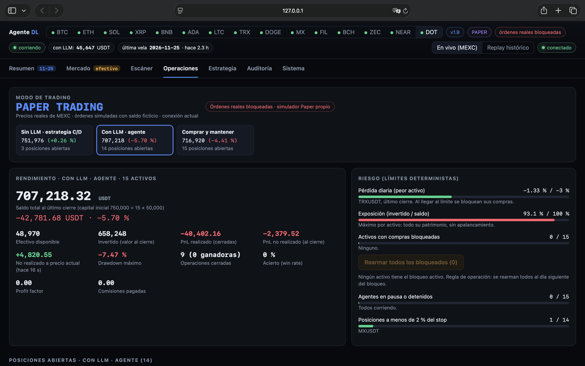

# Deep Learning para Finanzas — práctica y agente de IA financiero

Este repositorio reúne la **práctica** del curso, con el modelo de pronóstico de BTC/USDT, y el **proyecto final**: un agente de IA que opera en **modo Paper** (dinero virtual) con 15 pares de MEXC. El agente combina el modelo LSTM de cada activo, un LLM local (Ollama), controles de riesgo deterministas y una interfaz web.

> El agente **no envía órdenes reales**. Solo lee datos públicos de MEXC y ejecuta las compras y ventas en un simulador propio. Las claves no están en el repositorio.

**Informe del proyecto final:** [`Informe_Proyecto_Final_Agente_IA.md`](Informe_Proyecto_Final_Agente_IA.md) (o en PDF: [`Informe_Proyecto_Final_Agente_IA.pdf`](Informe_Proyecto_Final_Agente_IA.pdf)).

---

## Resultados en vivo (15 activos, datos al 25 nov 2026)

Cada activo tiene tres carteras de 50,000 USDT con el mismo periodo y costos:

| Cartera | Rendimiento neto | Drawdown máx. | Órdenes | Win Rate |
|---|---|---|---|---|
| Sin LLM (estrategia del modelo + riesgo) | **+0.26 %** | −0.93 % | 13 | 80 % (4 de 5) |
| Con LLM (propuesta del LLM + el mismo riesgo) | **−5.70 %** | −7.47 % | 32 | 0 % (0 de 9) |
| Comprar y mantener | **−4.41 %** | −7.04 % | 15 | — |

En este periodo el LLM no aportó valor:
- Nunca propuso vender.
- Propuso comprar sin señal del modelo en 20 de 114 ciclos.
- Todas sus salidas fueron por stop.

El motor de riesgo lo contuvo: rechazó 18 acciones no permitidas y forzó 9 ventas por stop. El detalle por activo y el análisis de las justificaciones del LLM están en el [informe](Informe_Proyecto_Final_Agente_IA.md).

**Meta de +20 %:** no se alcanzó; los periodos evaluados fueron bajistas y el protocolo solo permite comprar o estar en efectivo. Lo que sí se logró:
- El modelo profundo superó a la regresión lineal: en TE, −3.25 % frente a −27.98 %, con un RMSE menor.
- Protegió el capital frente a comprar y mantener: −3.25 % frente a −31.57 % en TE de BTC, mejor en 12 de 15 activos.
- En vivo, la cartera del modelo fue la única positiva (+0.26 %).

Ver la sección 10 del [informe](Informe_Proyecto_Final_Agente_IA.md).

### Capturas de la interfaz

| Operaciones (15 activos, modo Paper) | Cerebro (flujo de módulos) |
|---|---|
|  |  |
| **Control humano, observación y propuesta del LLM** | **Red neuronal en vivo** |
|  |  |

Más capturas (decisiones y órdenes, salud del sistema, auditoría y bitácora) en [`agente/evidencia/capturas/`](agente/evidencia/capturas/).

---

## Cómo funciona el agente

```
React + TypeScript (5173) ──X-API-Key──▶ Backend FastAPI (127.0.0.1:8000)
     ├─ MEXC API pública: velas diarias (solo lectura; sin rutas de órdenes reales)
     ├─ Un agente por activo: ensamble de 3 LSTM + escaladores versionados
     ├─ Gateway propio (8001) ──X-API-Key──▶ Ollama local (llama3.2:3b)
     ├─ Motor de riesgo determinista (el LLM no puede saltarlo)
     ├─ Simulador Paper (saldo, tamaño mínimo y precisión del par)
     └─ SQLite: ciclos, decisiones, órdenes, patrimonio y eventos
```

Una vez al día, después del cierre de la vela de 00:00 UTC, cada activo:
1. Consulta las velas cerradas de MEXC y valida la fecha y la antigüedad del dato.
2. Calcula los 20 rezagos y obtiene el pronóstico del modelo.
3. Pide al LLM una propuesta en JSON (comprar, mantener o vender) con una justificación breve.
4. Valida la propuesta y aplica los controles de riesgo:
   - límite de exposición;
   - pérdida diaria máxima de 3 %;
   - stop móvil;
   - antigüedad máxima del dato de 26 h.
5. Ejecuta en Paper, guarda todo y muestra el resultado en la interfaz.

Si falla una dependencia (MEXC, Ollama, clave incorrecta, JSON inválido, dato atrasado, etc.), el agente reintenta con espera creciente y se pausa sin operar. Los nueve escenarios de error del protocolo están demostrados en [`agente/evidencia/demostracion_errores.md`](agente/evidencia/demostracion_errores.md).

### Activos

BTC, ETH, SOL, XRP, BNB, ADA, LTC, TRX, DOGE, MX, FIL, BCH, ZEC, NEAR y DOT contra USDT.
- Cada uno tiene su propio modelo, entrenado y validado con sus datos (TR/VA/TE 70/15/15).
- La estrategia de cada uno (C o D) se eligió con el conjunto de validación.
- Los activos extra se eligieron con una regla de volumen fijada antes de entrenar.

---

## Ejecutarlo

Requisitos: Python 3.13, Node.js y [Ollama](https://ollama.com) con el modelo `llama3.2:3b`. Las instrucciones completas están en [`agente/README.md`](agente/README.md).

```bash
# 1. Entorno de Python y claves (una sola vez, desde esta carpeta)
python3.13 -m venv .venv && source .venv/bin/activate
pip install -r agente/backend/requirements.txt
cp agente/.env.example agente/.env      # y escribe dos claves propias (ver el archivo)
ollama pull llama3.2:3b

# 2. Gateway del LLM y backend (dos terminales, en agente/backend)
uvicorn gateway.main:app --host 127.0.0.1 --port 8001
uvicorn app.main:app --host 127.0.0.1 --port 8000

# 3. Interfaz (en agente/frontend)
npm install && npm run dev               # http://127.0.0.1:5173

# Pruebas y registros
cd agente/backend && python -m pytest    # 97 pruebas automatizadas
python agente/exportar_registros.py      # exporta las bases a CSV y calcula las métricas del informe
```

---

## Estructura del repositorio

| Carpeta o archivo | Contenido |
|---|---|
| [`Informe_Proyecto_Final_Agente_IA.md`](Informe_Proyecto_Final_Agente_IA.md) · [`Informe_Proyecto_Final_Agente_IA.pdf`](Informe_Proyecto_Final_Agente_IA.pdf) | Informe del proyecto final (bloques 14–16 del protocolo) |
| [`agente/`](agente/) | El agente: `backend/` (FastAPI + gateway de Ollama + pruebas), `frontend/` (React + TypeScript), `config/` (configuración de riesgo, LLM y activos), [`README.md`](agente/README.md) y [`CHANGELOG.md`](agente/CHANGELOG.md) (versiones v1.0 a v1.9) |
| [`agente/registros/`](agente/registros/) | Registros del agente en CSV (ciclos, decisiones, órdenes, patrimonio y eventos) y métricas calculadas |
| [`agente/evidencia/`](agente/evidencia/) | Verificación de los modelos en la computadora local, replay histórico de BTC y demostración de los nueve errores |
| [`notebooks/`](notebooks/) | Notebooks de Colab: avances de la práctica (`practica/`) y entrenamiento de los activos extra |
| [`modelos/`](modelos/) | Modelos y escaladores de la práctica (BTC); el agente usa los de `modelos/cap11/` |
| [`activos_extra/`](activos_extra/), [`activos_extra_lote2/`](activos_extra_lote2/), [`activos_extra_lote3/`](activos_extra_lote3/) | Modelos, escaladores, resultados y figuras de los 14 activos extra |
| [`datos/`](datos/), [`resultados/`](resultados/), [`figuras/`](figuras/), [`evidencia_t4/`](evidencia_t4/), [`bitacora/`](bitacora/) | Datos de MEXC, resultados, figuras, evidencia del entrenamiento en GPU T4 y bitácora de la práctica |
| [`Informe/`](Informe/) | Informe final de la práctica y anexos |

---

## Dónde está cada entregable del protocolo

### Práctica (avances 1 a 5, capítulos 7 a 11)

Los notebooks conservan sus salidas y se pueden abrir en Colab (solo lectura) desde los enlaces.

| Avance | Notebook | Abrir en Colab | Resultados principales |
|---|---|---|---|
| 1 · Capítulo 7: datos, partición y referencias | [`DLF_Cap08_Avance1.ipynb`](notebooks/practica/DLF_Cap08_Avance1.ipynb) | [Colab](https://colab.research.google.com/github/prisfig/agente_dl/blob/main/notebooks/practica/DLF_Cap08_Avance1.ipynb) | [`ficha_activo.json`](resultados/ficha_activo.json), [`diccionario_datos.csv`](resultados/diccionario_datos.csv), [`auditoria_datos.csv`](resultados/auditoria_datos.csv), [`particiones.csv`](resultados/particiones.csv), [`comparacion_modelos_cap7_VA.csv`](resultados/comparacion_modelos_cap7_VA.csv), [`hipotesis_tecnica.json`](resultados/hipotesis_tecnica.json) |
| 2 · Capítulo 8: MLP y LSTM en T4 | [`DLF_Cap08_Avance2.ipynb`](notebooks/practica/DLF_Cap08_Avance2.ipynb) | [Colab](https://colab.research.google.com/github/prisfig/agente_dl/blob/main/notebooks/practica/DLF_Cap08_Avance2.ipynb) | [`busqueda_configuraciones_cap8.csv`](resultados/busqueda_configuraciones_cap8.csv), [`resumen_semillas_cap8.csv`](resultados/resumen_semillas_cap8.csv), [`seleccion_cap8.json`](resultados/seleccion_cap8.json), curvas en [`figuras/`](figuras/) |
| 3 · Capítulo 9: ventanas expansivas y umbrales | [`DLF_Cap09_Avance3.ipynb`](notebooks/practica/DLF_Cap09_Avance3.ipynb) | [Colab](https://colab.research.google.com/github/prisfig/agente_dl/blob/main/notebooks/practica/DLF_Cap09_Avance3.ipynb) | [`ventanas_expansivas_cap9.csv`](resultados/ventanas_expansivas_cap9.csv), [`errores_por_ventana_cap9.csv`](resultados/errores_por_ventana_cap9.csv), [`umbrales_probados_cap9_VA.csv`](resultados/umbrales_probados_cap9_VA.csv), [`regla_seleccionada_cap9.json`](resultados/regla_seleccionada_cap9.json), [`diferenciacion_fraccionaria_TR_cap9.csv`](resultados/diferenciacion_fraccionaria_TR_cap9.csv) |
| 4 · Capítulo 10: entorno del agente | [`DLF_Cap10_Avance4.ipynb`](notebooks/practica/DLF_Cap10_Avance4.ipynb) | [Colab](https://colab.research.google.com/github/prisfig/agente_dl/blob/main/notebooks/practica/DLF_Cap10_Avance4.ipynb) | [`especificacion_entorno_cap10.json`](resultados/especificacion_entorno_cap10.json), [`transicion_manual_cap10.csv`](resultados/transicion_manual_cap10.csv), [`pruebas_abuso_entorno_cap10.csv`](resultados/pruebas_abuso_entorno_cap10.csv) |
| 5 · Capítulo 11: indicadores, TE y pronóstico futuro | [`DLF_Cap11_Avance5.ipynb`](notebooks/practica/DLF_Cap11_Avance5.ipynb) | [Colab](https://colab.research.google.com/github/prisfig/agente_dl/blob/main/notebooks/practica/DLF_Cap11_Avance5.ipynb) | [`comparacion_A_vs_B_VA_cap11.csv`](resultados/comparacion_A_vs_B_VA_cap11.csv), [`comparacion_C_D_VA_cap11.csv`](resultados/comparacion_C_D_VA_cap11.csv), [`indicadores_documentacion_cap11.csv`](resultados/indicadores_documentacion_cap11.csv), [`resultados_finales_TR_VA_TE.csv`](resultados/resultados_finales_TR_VA_TE.csv) |

| Entregable de la carpeta de entrega (sección 10) | Archivo |
|---|---|
| Datos originales y procesados | [`datos/originales/`](datos/originales/), [`datos/procesados/`](datos/procesados/) |
| Evidencia de entrenamiento en T4 (`nvidia-smi`, dispositivo, versiones) | [`evidencia_t4/`](evidencia_t4/) |
| Modelo final y escaladores | [`modelos/cap11/`](modelos/cap11/), [`configuracion_final_congelada.json`](resultados/configuracion_final_congelada.json) |
| `experimentos.csv` | [`resultados/experimentos.csv`](resultados/experimentos.csv) |
| `predicciones_TE.csv` | [`resultados/predicciones_TE.csv`](resultados/predicciones_TE.csv) |
| `prediccion_futura.csv` | [`resultados/prediccion_futura.csv`](resultados/prediccion_futura.csv) |
| `simulacion.csv` | [`resultados/simulacion.csv`](resultados/simulacion.csv), con el resumen en [`resultados_trading_TE.csv`](resultados/resultados_trading_TE.csv) |
| Cuatro fallos provocados y bitácora de errores | [`pruebas_controladas_errores.csv`](resultados/pruebas_controladas_errores.csv), [`bitacora/bitacora_errores.csv`](bitacora/bitacora_errores.csv) |
| Informe de la práctica y anexos | [`Informe/`](Informe/) |

### Proyecto final (bloques 14 a 16)

| Requisito | Dónde |
|---|---|
| Frontend React + TypeScript | [`agente/frontend/`](agente/frontend/); capturas en [`agente/evidencia/capturas/`](agente/evidencia/capturas/) |
| Backend autenticado (FastAPI) y gateway de Ollama con API key | [`agente/backend/`](agente/backend/) |
| LLM realmente local (modelo, versión, hardware, tiempo, consulta sin internet) | [`agente/evidencia/ollama_local.txt`](agente/evidencia/ollama_local.txt) |
| README de instalación y ejecución | [`agente/README.md`](agente/README.md) |
| `.env.example` sin valores | [`agente/.env.example`](agente/.env.example) |
| Modelo y escalador versionados | Rutas y huellas en [`agente/config/agente.json`](agente/config/agente.json); verificación en [`agente/evidencia/`](agente/evidencia/) |
| Configuración del LLM y de riesgo | [`agente/config/agente.json`](agente/config/agente.json) |
| Base o exportación de registros | [`agente/registros/`](agente/registros/) |
| Pruebas automatizadas de controles | [`agente/backend/tests/`](agente/backend/tests/); salida en [`agente/evidencia/pytest_resultado.txt`](agente/evidencia/pytest_resultado.txt) |
| Al menos 20 ciclos válidos (replay separado) | [`agente/registros/ciclos.csv`](agente/registros/ciclos.csv) (columna `modo`) y [`agente/evidencia/replay_v2_2026-11-05_a_14.csv`](agente/evidencia/replay_v2_2026-11-05_a_14.csv) |
| Nueve errores demostrados | [`agente/evidencia/demostracion_errores.md`](agente/evidencia/demostracion_errores.md) |
| Comparación sin LLM / con LLM / comprar y mantener | [`Informe_Proyecto_Final_Agente_IA.md`](Informe_Proyecto_Final_Agente_IA.md) y [`agente/registros/metricas_por_activo.csv`](agente/registros/metricas_por_activo.csv) |
| Informe breve | [`Informe_Proyecto_Final_Agente_IA.md`](Informe_Proyecto_Final_Agente_IA.md) · [`Informe_Proyecto_Final_Agente_IA.pdf`](Informe_Proyecto_Final_Agente_IA.pdf) |

---

## Práctica: modelo de pronóstico de BTC/USDT

- **Datos:** velas diarias de BTC/USDT de MEXC, de septiembre de 2018 a noviembre de 2026.
- **División:** entrenamiento (TR), validación (VA) y prueba (TE), en orden cronológico.
- **Modelo final:** ensamble de 3 LSTM (semillas 42, 123 y 2024) con 20 rezagos del rendimiento diario.
- **Estrategia D:** compra si el pronóstico supera δ = 0.0866 % y el cierre está por encima de la SMA20.
- **Congelado antes del TE:** la configuración se fijó con VA y se guardó con su SHA-256 en [`resultados/configuracion_final_congelada.json`](resultados/configuracion_final_congelada.json). El TE se usó una sola vez: −3.25 % frente a −31.57 % de comprar y mantener.

El agente reutiliza ese modelo sin reentrenarlo y comprueba con [`agente/verificar_modelo.py`](agente/verificar_modelo.py) que en esta computadora da las mismas predicciones que en Colab.

---

## Seguridad

- Las claves viven solo en `agente/.env`, que no se sube al repositorio. Se entrega [`agente/.env.example`](agente/.env.example) sin valores.
- La interfaz no guarda claves en el código ni en variables `VITE`.
- Iniciar, detener y cambiar la configuración requieren la clave del backend.
- El LLM no recibe claves, no puede cambiar la configuración y sus acciones no válidas se rechazan.
- No hay ninguna ruta que envíe órdenes reales a MEXC, y no se usa una clave de trading.
